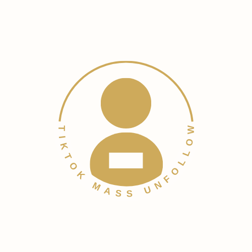

  

# TikTok Mass Unfollow Extension

**TikTok Mass Unfollow** è un'estensione per Chrome che automatizza l'azione di "unfollow" su tutti gli account che segui su TikTok. Usa questa estensione con cautela, poiché comporta il rischio che TikTok limiti o blocchi azioni automatizzate se eseguite troppo rapidamente.

---

## Caratteristiche

- Rilevamento automatico dei pulsanti "Following" sulla scheda del profilo.
- Esecuzione dei click sui pulsanti di "unfollow" con un ritardo di 0.8 secondi tra ciascuno.
- Gestione intelligente del caricamento dei pulsanti, con mechanism di retry automatico.

---

## Installazione (Modalità Sviluppatore)

1. Scarica o clona il repository sul tuo computer.
2. Apri Chrome e visita `chrome://extensions/`.
3. Attiva la **Modalità sviluppatore** in alto a destra.
4. Seleziona **Carica estensione non pacchettizzata**.
5. Scegli la cartella del progetto (`TikTokUnfollow`).

L'estensione sarà attiva e funzionante su tutte le pagine dei profili TikTok.

---

## Utilizzo

1. Accedi al tuo profilo TikTok e apri la scheda **Following**.
2. L'estensione inizierà automaticamente il processo di "unfollow" degli account.
3. Per monitorare il progresso, apri la Console di Chrome (F12 → Console) e osserva i log.

---

## Struttura dei File

- **manifest.json**: Configurazione dell'estensione Chrome.
- **contentScript.js**: Script principale che gestisce il processo di unfollow automatico.

---

## Disclaimer e Politiche

- **Uso a tuo rischio:** L'estensione viene fornita "così com’è" e senza garanzie. L'autore non si assume responsabilità per eventuali blocchi, sospensioni o limitazioni dell'account TikTok.
- **Proprietà intellettuale:** TikTok e il relativo logo sono marchi registrati di TikTok Inc. Questa estensione non è affiliata, approvata o sponsorizzata da TikTok.
- **Privacy:** L'estensione non raccoglie o trasmette dati personali. Tutte le operazioni avvengono localmente nel browser.
- **Distribuzione:** È responsabilità dell’utente rispettare le leggi locali e le politiche di TikTok. L'autore non incoraggia l'uso incompatibile con i termini di servizio della piattaforma.

---

## Licenza

Distribuito sotto licenza MIT  
Copyright (c) 2025 Kevinxvii

